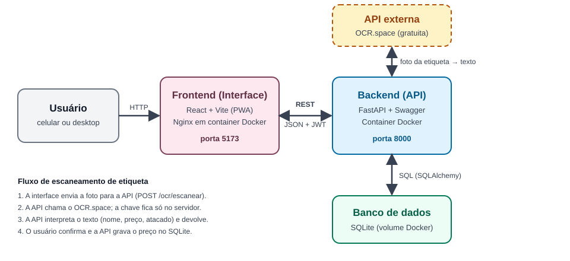

# Confeitaria — Compras e Comparação de Preços

Sistema web para gerenciar as compras de uma confeitaria. A pessoa cria listas de compras, tira foto da etiqueta de preço na gôndola do mercado e o sistema reconhece o nome do produto, o preço e a quantidade mínima (preços de atacado). Um painel compara os preços entre fornecedores e mostra como eles variam ao longo do tempo.

Projeto do MVP de componentização (serviços autônomos que se comunicam por REST). Funciona no celular (PWA, mobile-first) e no desktop.

## Sumário

- [Arquitetura](#arquitetura)
- [Repositórios](#repositórios)
- [API externa utilizada](#api-externa-utilizada-ocrspace)
- [Como executar](#como-executar)
- [Rotas da API](#rotas-da-api)
- [Funcionalidades](#funcionalidades)
- [Estrutura de pastas](#estrutura-de-pastas)

## Arquitetura



O sistema tem três módulos que se comunicam por REST/JSON:

| Módulo | Papel | Tecnologia | Desenvolvido por nós |
|---|---|---|---|
| **Frontend** (interface) | Telas de listas, escaneamento, painel e fornecedores | React + Vite (PWA), servido por Nginx | Sim |
| **Backend** (API) | Regras de negócio, autenticação, persistência e integração com o OCR | FastAPI + SQLAlchemy + SQLite | Sim |
| **OCR.space** (API externa) | Reconhecimento de texto na foto da etiqueta | API REST pública e gratuita | Não |

Estratégia de comunicação:

- O frontend só fala com o backend, por REST com JSON e autenticação por token JWT.
- Quem chama a API externa é o backend, e não o navegador. Assim a chave do OCR.space fica protegida no servidor.
- O OCR.space devolve apenas o texto bruto. A interpretação desse texto (nome, preço, unidade e faixa de atacado) é código nosso, em `backend/app/interpretacao.py`.
- O usuário sempre confirma ou corrige o que foi lido antes de o preço ser salvo.

## Repositórios

Cada componente desenvolvido tem repositório próprio, com seu Dockerfile na raiz:

| Componente | Repositório |
|---|---|
| Frontend (interface, contém o `docker-compose.yml`) | https://github.com/SEU_USUARIO/frontend |
| Backend (API) | https://github.com/SEU_USUARIO/backend |

> Troque `SEU_USUARIO` e os nomes pelos endereços reais dos repositórios.

## API externa utilizada: OCR.space

| Item | Informação |
|---|---|
| Serviço | [OCR.space](https://ocr.space/ocrapi) — reconhecimento de texto (OCR) em imagens |
| Custo | Plano gratuito, sem cartão de crédito. Confira os limites atuais na [página da API](https://ocr.space/ocrapi) |
| Licença | Serviço online proprietário, usado conforme os termos de uso do OCR.space. Não há código de terceiros no projeto |
| Cadastro | Necessário: peça uma chave gratuita em https://ocr.space/ocrapi/freekey e coloque em `CHAVE_API_OCR_SPACE` no `.env` do backend |
| Rota utilizada | `POST https://api.ocr.space/parse/image` |

Parâmetros enviados (multipart/form-data): `file` (a imagem), `apikey`, `language=por`, `OCREngine=2`, `scale=true` e `isTable=false`.

Campos usados da resposta: `ParsedResults[0].ParsedText` (texto reconhecido), `IsErroredOnProcessing` e `ErrorMessage` (tratamento de erro).

O usuário não é redirecionado para o site do OCR.space em nenhum momento: o backend consome a resposta e devolve ao frontend os dados já tratados.

## Como executar

### Pré-requisitos

- [Docker Desktop](https://docs.docker.com/desktop/) (no Windows, com WSL2 habilitado e virtualização ativa na BIOS)
- Uma chave gratuita do OCR.space (veja acima)
- Para rodar sem Docker: Python 3.12+ e Node.js 20+

### Com Docker (recomendado)

1. Clone os dois repositórios lado a lado, com estes nomes de pasta:

   ```text
   projeto/
   ├── backend/
   └── frontend/
   ```

2. Crie o arquivo de configuração do backend:

   ```bash
   cd backend
   cp .env.example .env
   ```

3. Edite `backend/.env`: preencha `CHAVE_API_OCR_SPACE` e troque `SENHA_APP` e `SEGREDO_JWT` por valores próprios. Para gerar valores seguros:

   ```bash
   python -c "import secrets; print(secrets.token_urlsafe(48))"   # SEGREDO_JWT
   python -c "import secrets; print(secrets.token_urlsafe(12))"   # SENHA_APP
   ```

4. Suba os dois containers a partir da pasta do frontend:

   ```bash
   cd ../frontend
   docker compose up --build
   ```

5. Acesse:

   | O quê | Endereço |
   |---|---|
   | Aplicação (frontend) | http://localhost:5173 |
   | Documentação Swagger da API | http://localhost:8000/docs |

6. Entre com o usuário e a senha definidos em `USUARIO_APP` e `SENHA_APP`.

Para parar: `docker compose down` (os dados ficam no volume `backend-data`).

### Dados de demonstração (opcional)

Popula fornecedores, produtos, histórico de preços e uma lista de compras fictícios, útil para conhecer o painel sem escanear etiquetas:

```bash
docker compose exec backend python scripts/popular_demo.py
```

> Atenção: o script apaga todos os dados existentes antes de popular.

### Sem Docker

Backend:

```bash
cd backend
python -m venv .venv
.venv\Scripts\activate          # Linux/macOS: source .venv/bin/activate
pip install -r requirements.txt
cp .env.example .env            # edite como no passo 3 acima
uvicorn app.main:app --reload
```

Frontend (em outro terminal):

```bash
cd frontend
npm install
cp .env.example .env            # ajuste VITE_URL_API se o backend não estiver em localhost:8000
npm run dev
```

## Rotas da API

Todas exigem token JWT, exceto `/autenticacao/entrar` e `/saude`. A documentação interativa completa está em `/docs`.

| Método | Rota | Descrição |
|---|---|---|
| POST | `/autenticacao/entrar` | Login; devolve o token JWT |
| GET, POST | `/fornecedores` | Listar e criar fornecedores |
| GET, PUT, DELETE | `/fornecedores/{id}` | Consultar, editar e remover fornecedor |
| GET, POST | `/produtos` | Listar (com busca) e criar produtos |
| GET, DELETE | `/produtos/{id}` | Consultar e remover produto |
| GET, POST | `/listas-compras` | Listar e criar listas de compras |
| GET, PUT, DELETE | `/listas-compras/{id}` | Consultar, editar e remover lista |
| POST | `/listas-compras/{id}/itens` | Adicionar item à lista |
| PATCH, DELETE | `/listas-compras/{id}/itens/{item_id}` | Marcar como comprado, editar ou remover item |
| POST | `/ocr/escanear` | Recebe a foto da etiqueta e devolve nome, preço e quantidade sugeridos |
| GET, POST | `/registros-preco` | Histórico de preços (filtros por produto e fornecedor) |
| GET, PUT, DELETE | `/registros-preco/{id}` | Consultar, corrigir e remover registro de preço |
| GET | `/painel/comparacao-precos` | Preço mais recente de um produto em cada fornecedor |
| GET | `/painel/historico-precos` | Variação do preço ao longo do tempo |
| GET | `/painel/destaques` | Destaques automáticos (fornecedor mais competitivo, altas de preço) |
| GET | `/saude` | Verificação de disponibilidade |

## Funcionalidades

- **Listas de compras** salvas com data, com itens que podem ser riscados manualmente ou pelo escaneamento.
- **Escaneamento de etiqueta** pela câmera do celular, com detecção de preço, unidade e faixas de atacado ("leve 6", "cx c/ 12") e tela de confirmação antes de salvar.
- **Fornecedores** de varejo e atacado.
- **Painel** com gráfico de comparação entre fornecedores, gráfico de variação de preço no tempo e destaques automáticos.
- **Autenticação** por usuário e senha com token JWT.
- **PWA**: pode ser instalado na tela inicial do celular.

## Estrutura de pastas

```text
projeto/
├── backend/                  # API (repositório próprio)
│   ├── app/
│   │   ├── main.py           # criação da aplicação e rotas
│   │   ├── modelos.py        # tabelas do banco (SQLAlchemy)
│   │   ├── esquemas.py       # contratos de entrada e saída (Pydantic)
│   │   ├── interpretacao.py  # texto do OCR -> nome, preço e atacado
│   │   ├── seguranca.py      # autenticação JWT
│   │   ├── ocr/              # provedor de OCR (OCR.space) trocável
│   │   └── rotas/            # endpoints por recurso
│   ├── scripts/popular_demo.py
│   ├── Dockerfile
│   └── requirements.txt
├── frontend/                 # interface (repositório próprio)
│   ├── src/
│   │   ├── paginas/          # telas
│   │   ├── componentes/      # estrutura, navegação, rota protegida
│   │   ├── contexto/         # autenticação
│   │   └── api/cliente.js    # chamadas à API
│   ├── Dockerfile
│   └── docker-compose.yml    # sobe frontend + backend
└── docs/arquitetura.svg      # fluxograma da arquitetura
```
